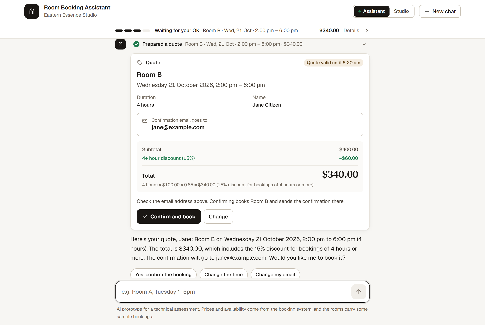
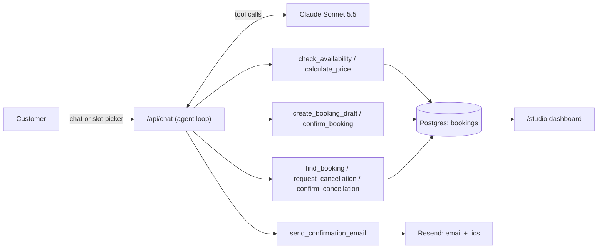

# Room Booking Assistant

An AI agent that books **Room A** and **Room B** for Eastern Essence Studio through a chat. It checks availability, prices the booking by duration, collects the customer's details and emails a confirmation once the customer accepts the quote. The welcome screen shows when each room is free this week, customers can move or cancel a booking, and the studio has its own view of everything the assistant did.

**Live demo: [space-booking-agent.vercel.app](https://space-booking-agent.vercel.app)** · **Studio view: [/studio](https://space-booking-agent.vercel.app/studio)**



## Try it

1. `Book Room B next Wednesday from 2pm to 6pm` → Room B is free, and a short form in the chat asks for your name and email (typing them works too). The quote shows **$340.00** (4 hours, 15% off) and the email address again so you can check it. Reply `yes` and the booking is confirmed and emailed to you.
2. `A 3-hour workshop next Friday afternoon` → the assistant checks both rooms that afternoon and suggests concrete free slots with the price, instead of asking you to pick a time.
3. Tap a start time on a room card on the welcome screen, or a free time in the assistant's availability card → choose the length with the price shown on every option, then **Get a quote**.
4. After booking, tap **Move this booking** (`Move this booking to 6pm to 10pm`) or **Cancel this booking**. Both show what will change and wait for your OK, and both send an email.
5. `Is Room A free this Friday from 2pm to 6pm?` → Room A is taken, so the assistant offers other times and the other room, each with its price.
6. Tap the summary bar under the header for the full booking and every step the assistant took, or open **Studio** in the header to see bookings, conversion, room utilisation and every conversation step by step.

Use a real email address to receive the confirmation. Reserved test domains such as example.com can't receive mail, so nothing is sent to them, but the email can still be previewed from the chat. Bookings are real and shared by everyone testing the demo. If an earlier test already took a slot, the assistant says so and offers other times. Every step the agent takes appears in the chat as a plain-language line; click one to see its inputs and results, and again for the raw JSON.

## What the brief asked for

| Requirement | How it's met |
|---|---|
| Check availability of Room A and Room B | `check_availability` against the live booking database; the welcome screen shows when both rooms are free this week |
| Collect customer details | The assistant asks for name and email once a room is free; a form in the chat checks the format and catches typos like "gmial.com", and the quote shows the email again before anything is booked. The "Your booking" panel shows what has been collected |
| Duration-based pricing (< 4 h at $100/h, ≥ 4 h with 15% off) | Calculated in code, never by the model; boundary cases are unit-tested |
| Email confirmation after the price is accepted | Sent only after the customer confirms in a new message; includes name, room, date and time, duration and total, plus a calendar invite |

Beyond the brief: a visual slot picker with live prices, moving and cancelling bookings (verified by reference and email), and a studio dashboard with masked customer details.

## How it works



The model holds the conversation and extracts dates, times and details. Everything that has to be correct is code:

- **Pricing is deterministic.** Durations come from clock times and prices are computed in integer cents (`lib/pricing.ts`). The model only repeats numbers a tool returned, and the slot picker uses the same function.
- **Nothing happens without the customer's OK.** Quotes and cancellation requests are held server-side; `confirm_booking` and `confirm_cancellation` refuse to run in the same turn the quote or request was made.
- **No double bookings.** A Postgres exclusion constraint rejects overlapping bookings for the same room. Moving a booking cancels the old one and inserts the new one in a single transaction, so a clash leaves the original untouched.
- **A booking is only revealed with its reference and its email together**, and either one wrong gives the same answer. The public studio view masks names, emails and references and never shows booking ids.
- **Emails can't go wrong or go twice.** Each email (confirmed, updated, cancelled) is built from the stored booking and sent at most once. If the model forgets to send one, the server sends it.
- **Server-side history.** The conversation is stored on the server, so a client can't inject fake tool results.
- **A dropped connection doesn't lose a booking.** If the customer closes the tab mid-reply, the turn still finishes on the server: the booking is saved and the email goes out.

Assumptions: Australian Eastern time (AEDT); open 8am to 10pm daily; bookings in 30-minute steps, at least 1 hour, within one day; both rooms at $100/hour.

## Testing

- **169 unit tests** (`npm test`): pricing boundaries (3 h = $300, 4 h = $340, 4.5 h = $382.50, 5 h = $425, a full 14-hour day = $1,190), time parsing, opening hours and the 180-day window, daylight-saving changeover days, availability, the confirmation rule, concurrent bookings, moving into an overlapping slot, a move that loses its slot leaving the original intact, cancellation, email idempotency per kind, the email tool refusing bookings from other conversations, reserved test addresses (example.com) being previewed instead of sent, the studio never exposing booking ids, references or customer names, when the chat offers the details form, upgrading an older database schema in place, masking, rate limits, and the agent loop against a scripted model, including a tool crashing mid-turn.
- **36 end-to-end conversation evals** (`npm run eval`) run against the real model and check the database afterwards: the 4-hour discount, an 8-hour day, room conflicts, refusing to skip confirmation, saying yes twice, correcting an email, haggling and a "system override" price injection, moving a booking (including one from an earlier chat), cancelling only after confirmation, refusing a wrong email, a quote that expires before the yes, asking the price and then saying yes (one yes books it), a rough time ("next Friday afternoon") answered with concrete free slots, the sentence the details form sends, both rooms at once, past, too-early, too-late, too-short, off-grid and too-far-ahead times, an invalid email, phrasings like "half past two until six", and a request in Chinese. Latest run: **36/36 passed** on Claude Sonnet 5.5, median reply 5.2 s, about $0.86 for the suite.
- **25 browser checks** (`node scripts/ui-edge.mjs <url>`, headless Chrome): blank and over-long messages, double sends, server errors with retry, rate limits, a reply cut off mid-stream, the details form (format check, typo suggestion, Chinese, phone width), room cards and availability cards opening the slot picker, the booking summary, slot picker rules and keyboard use, reduced motion, layouts at phone width, and a real booking with a very long name and email.
- `node scripts/contrast-check.mjs` verifies every colour pair in the design tokens meets WCAG AA.

## Run it locally

```bash
npm install
cp .env.example .env.local   # add ANTHROPIC_API_KEY
npm run dev                  # http://localhost:3000
```

Without `DATABASE_URL` the app uses an embedded Postgres (PGlite) in `.data/`. Without `RESEND_API_KEY`, emails are logged instead of sent and can be previewed from the chat. `npm run email:test -- you@example.com` sends one real confirmation to check email settings.

To deploy: import the repo into Vercel, add a Neon Postgres database from the Storage tab (it sets `DATABASE_URL`), add the other variables from `.env.example`, and deploy. Tables and demo bookings are created on first use and upgraded in place. Functions run in Sydney (`vercel.json`).

## Project layout

```
app/components/      Chat UI, cards, room availability, slot picker, booking summary, studio dashboard
app/api/             Chat stream, schedule and day availability, studio data, email preview
lib/agent/           System prompt, tool definitions, agent loop
lib/pricing.ts       Duration-based pricing
lib/bookings.ts      Availability, quotes, bookings, moves and cancellations
lib/email.ts         Booking emails and calendar invites
lib/studio.ts        Dashboard figures, transcripts and masking
tests/, evals/       Unit tests and conversation evals
```
