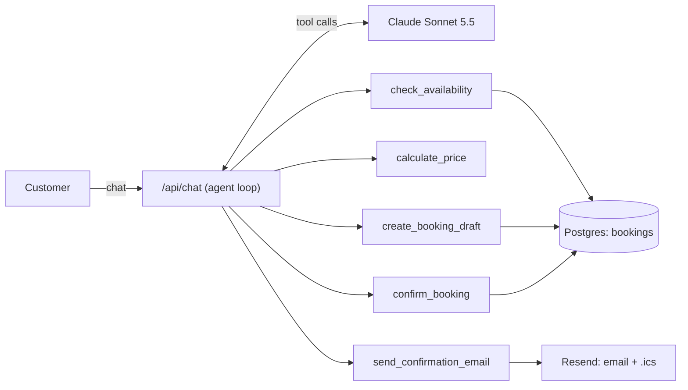

# Room Booking Assistant

An AI agent that books **Room A** and **Room B** for Eastern Essence Studio through a chat. It checks availability, prices the booking by duration, collects the customer's details and emails a confirmation once the customer accepts the quote.

**Live demo:** _link added on deployment_ · **Walkthrough video (3 min):** _link added on deployment_

## Try it

Open the demo and type, or tap one of the suggestions:

1. `Book Room B this Friday from 2pm to 6pm. I'm Jane Citizen, jane@example.com` → you get a quote of **$340.00** (4 hours, 15% off). Reply `yes` and the booking is confirmed and emailed.
2. `Is Room A free this Friday from 2pm to 6pm?` → Room A is already taken, so the agent offers other times and the other room.
3. `Room A on Sunday 2:30pm to 6pm` → $350.00, and the agent points out that 4 hours would cost less ($340.00).

Bookings are real and shared by everyone testing the demo. If an earlier test already took a slot, the agent says so and offers other times.

Switch on **Agent trace** in the header to see every tool call the agent makes and its result.

## What the brief asked for

| Requirement | How it's met |
|---|---|
| Check availability of Room A and Room B | `check_availability` tool against the live booking database; a week view shows both rooms |
| Collect customer details | Name and email are captured into a quote; the "Your booking" panel shows what has been collected |
| Duration-based pricing (< 4 h at $100/h, ≥ 4 h with 15% off) | Calculated in code, never by the model; boundary cases are unit-tested |
| Email confirmation after the price is accepted | Sent only after the customer confirms in a new message; includes name, room, date and time, duration and total, plus a calendar invite |

## How it works



The model holds the conversation and extracts dates, times and details. Everything that has to be correct is code:

- **Pricing is deterministic.** Durations come from clock times and prices are computed in integer cents (`lib/pricing.ts`). The model only repeats numbers a tool returned.
- **The flow is enforced by the tools, not just the prompt.** `create_booking_draft` validates the request and returns a quote held for 15 minutes. `confirm_booking` refuses to run in the same turn the quote was made, so nothing is booked until the customer replies.
- **No double bookings.** A Postgres exclusion constraint rejects overlapping bookings for the same room, even if two customers confirm at the same moment.
- **Emails can't go wrong or go twice.** The email is built from the stored booking, not from model text, and is sent at most once per booking. If the model forgets to call the email tool, the server sends it anyway.
- **Server-side history.** The conversation is stored on the server, so a client can't inject fake tool results.

Assumptions: Sydney time; open 8am to 10pm daily; bookings in 30-minute steps, at least 1 hour, within one day; both rooms at $100/hour.

## Testing

- **80 unit tests** (`npm test`) cover pricing boundaries (3 h = $300, 4 h = $340, 4.5 h = $382.50, 5 h = $425), time parsing and validation, availability, the confirmation rule, concurrent bookings, idempotent emails and the agent loop against a scripted model.
- **11 end-to-end conversation evals** (`npm run eval`) run against the real model and check the database afterwards: exact-4-hour discount, standard rate, the 3.5 h vs 4 h tip, room conflicts, price questions, "next Friday from 9 to 5", refusing to skip confirmation, saying yes twice, correcting an email, haggling, and a request in Chinese. Latest run: **11/11 passed** on Claude Sonnet 5.5, median reply 4.5 s, about $0.17 for the whole suite.

## Run it locally

```bash
npm install
cp .env.example .env.local   # add ANTHROPIC_API_KEY
npm run dev                  # http://localhost:3000
```

Without `DATABASE_URL` the app uses an embedded Postgres (PGlite) in `.data/`. Without `RESEND_API_KEY`, emails are logged instead of sent and can be previewed from the chat.

To deploy: import the repo into Vercel, add a Neon Postgres database from the Storage tab (it sets `DATABASE_URL`), add the other variables from `.env.example`, and deploy. Tables and demo bookings are created on first use. Functions run in Sydney (`vercel.json`).

## Project layout

```
app/components/      Chat UI, cards, booking panel, week timeline
app/api/chat/        Streams the agent's replies and tool results
lib/agent/           System prompt, tool definitions, agent loop
lib/pricing.ts       Duration-based pricing
lib/bookings.ts      Availability, quotes, confirmations
lib/email.ts         Confirmation email and calendar invite
tests/, evals/       Unit tests and conversation evals
```
